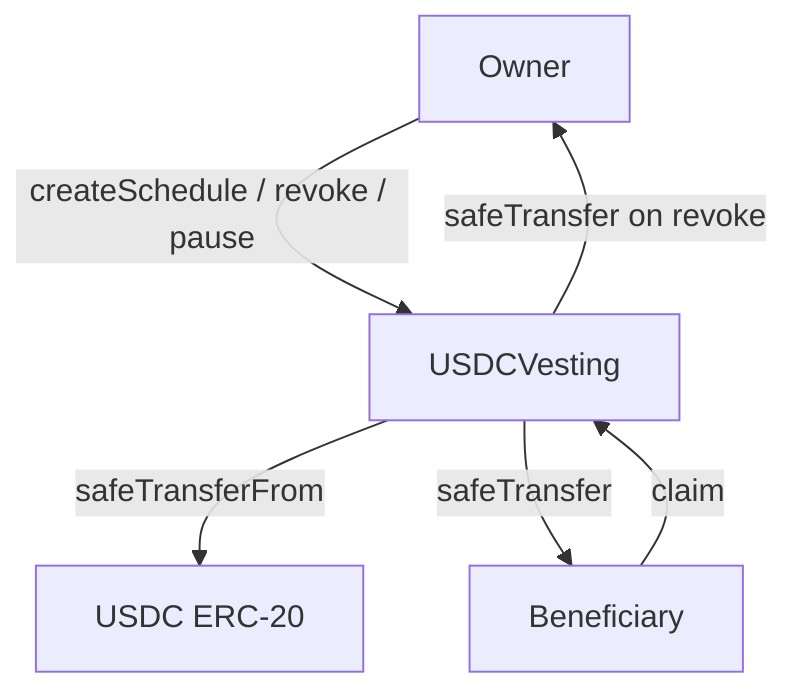
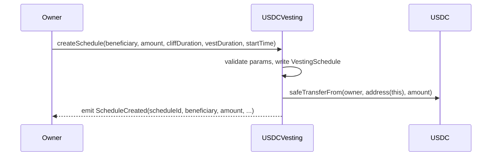

# USDCVesting — Contract Design Document

**Status:** Draft  
**Authors:** Arc Studio  
**Target Chain:** Arc Testnet (chainId 5042002)  
**Language / Toolchain:** Solidity 0.8.24, Foundry (forge)  
**Milestone:** v1.0  

### Review Tracker
- [ ] Design Review — TBD
- [ ] Security Review — TBD
- [ ] Ops Review — TBD

---

## Action Items (living)

_Starts empty. Populated after each review round._

---

## 1. Goals / Non-Goals

### Goals
- Allow a project owner to lock USDC for multiple beneficiaries under separate vesting schedules.
- Enforce a cliff period (no unlock before the cliff timestamp).
- After the cliff, unlock USDC linearly until the end of the vesting duration.
- Allow the owner to revoke any schedule early; unvested USDC returns to the owner.
- Allow the owner to pause the contract, blocking all claims.
- Emit events sufficient for off-chain monitoring of every state change.

### Non-Goals
- Multi-token support (USDC only).
- Upgradability — contract is immutable after deployment.
- Governance, multi-sig, or timelock on the owner role (out of scope for v1; see Priorities).
- Cross-chain vesting or bridging.
- Staking or yield on locked USDC.

---

## 2. Requirements

### Functional
- FR-1: Owner calls `createSchedule(beneficiary, totalAmount, cliffDuration, vestingDuration, startTime)` to create a schedule; USDC is pulled from owner at creation time via `transferFrom`.
- FR-2: A beneficiary may call `claim(scheduleId)` to withdraw any vested, unclaimed USDC at any time after the cliff.
- FR-3: Owner may call `revoke(scheduleId)` at any time; vested-but-unclaimed USDC is claimable by the beneficiary, unvested USDC returns immediately to the owner.
- FR-4: Owner may call `pause()` / `unpause()` to freeze / unfreeze all claims.
- FR-5: `vestedAmount(scheduleId, timestamp)` is a public view function that returns the total vested as of any timestamp.
- FR-6: Multiple schedules per beneficiary address are supported (array of scheduleIds per beneficiary).

### Security
- SR-1: Only the owner may create schedules, revoke, pause, or unpause.
- SR-2: Only the beneficiary of a schedule may claim it.
- SR-3: No path may allow double-claim (claimed amounts are tracked cumulatively).
- SR-4: Revocation of an already-revoked or fully-claimed schedule must revert cleanly.
- SR-5: All external ERC-20 calls use OpenZeppelin `SafeERC20`.
- SR-6: CEI (Check-Effects-Interact) ordering is enforced on every external-call site.
- SR-7: Timestamp comparisons tolerate minor miner drift (stated tolerance: ±15 s) and are not used for randomness.

---

## 3. Terminology & Actors

### Terms
| Term | Definition |
|---|---|
| Schedule | A single vesting agreement: beneficiary, total USDC, cliff, duration, start. |
| Cliff | Absolute timestamp before which zero USDC is unlocked. |
| Vesting duration | Seconds from `startTime` over which tokens unlock linearly after the cliff. |
| Vested amount | USDC unlocked as of a given timestamp (0 before cliff, linear after, capped at total). |
| Claimed amount | Cumulative USDC already withdrawn by the beneficiary. |
| Claimable amount | `vestedAmount(now) - claimedAmount` — what may be withdrawn right now. |
| Revocation | Owner action that marks a schedule inactive; unvested USDC returns to owner. |

### Actors

| Actor | On/Off-chain | Trust Level | Capabilities |
|---|---|---|---|
| Owner | Off-chain (EOA or multisig) | Trusted | Create schedules, revoke, pause, unpause, receive returned USDC |
| Beneficiary | Off-chain (EOA or contract) | Semi-trusted (untrusted for access control) | Claim vested USDC for their own schedule(s) |
| Contract | On-chain | N/A | Holds locked USDC, enforces vesting math |
| USDC ERC-20 | On-chain (0x3600…0000 on Arc Testnet) | Trusted external dependency | Source of truth for balances/transfers |

---

## 4. Language / Runtime

- **Solidity 0.8.24** — built-in overflow checks; no SafeMath required except `unchecked` blocks (none planned).
- **Compiler**: locked at `0.8.24` in `foundry.toml`.
- **EVM Hardfork**: Shanghai (EIP-3855 PUSH0 available; Arc Testnet supports Shanghai+).
- **Base contracts**: OpenZeppelin v5 (`Ownable2Step`, `Pausable`, `ReentrancyGuard`, `SafeERC20`, `IERC20`).
- **No proxy**: immutable deployment.

---

## 5. Transaction & Execution Model

All functions execute atomically. If any condition check or external call reverts, all state changes in that call are rolled back.

**Re-entry surface:**
- `createSchedule`: calls `safeTransferFrom` AFTER writing schedule state (CEI).
- `claim`: updates `claimedAmount` BEFORE calling `safeTransfer` (CEI).
- `revoke`: updates schedule state (marks revoked, captures unvested amount) BEFORE transferring USDC to owner (CEI).
- All three external-call sites are also guarded by `nonReentrant`.

---

## 6. Chain Standards & Interfaces

- **Token standard consumed**: ERC-20 (USDC, `decimals()` = 6).
- **No token standard implemented**: this contract does NOT mint any token.
- **SafeERC20** wraps all `transfer` / `transferFrom` calls to handle non-standard return values.
- **Ownable2Step** (OZ v5): owner transfer is two-step; `renounceOwnership` is overridden to revert.

_Cross-chain mapping table: N/A — single-chain deployment._

---

## 7. Architecture Overview

### Component Diagram



### Sequence: createSchedule



### Sequence: claim

```mermaid
sequenceDiagram
    participant Beneficiary
    participant USDCVesting
    participant USDC
    Beneficiary->>USDCVesting: claim(scheduleId)
    USDCVesting->>USDCVesting: calc claimable = vested(now) - claimed; update claimed
    USDCVesting->>USDC: safeTransfer(beneficiary, claimable)
    USDCVesting-->>Beneficiary: emit Claimed(scheduleId, beneficiary, claimable)
```

### Sequence: revoke

```mermaid
sequenceDiagram
    participant Owner
    participant USDCVesting
    participant USDC
    Owner->>USDCVesting: revoke(scheduleId)
    USDCVesting->>USDCVesting: calc unvested = total - vested(now); mark revoked
    USDCVesting->>USDC: safeTransfer(owner, unvested)
    USDCVesting-->>Owner: emit ScheduleRevoked(scheduleId, unvested)
```

### Flow of Funds

| Step | Who moves what | Invariant |
|---|---|---|
| `createSchedule` | Owner → Contract: `totalAmount` USDC | `contractBalance >= sum(active schedule allocations)` |
| `claim` | Contract → Beneficiary: `claimable` USDC | `claimedAmount[id] <= vestedAmount(id, now)` always |
| `revoke` | Contract → Owner: `unvestedAmount` USDC | `unvestedAmount = totalAmount - vestedAmount(now)` |

**Resting-state invariant:** `USDC.balanceOf(address(this)) == sum over all active schedules of (totalAmount - claimedAmount - (revoked ? unvestedReturnedToOwner : 0))`

---

## 8. Contract Design

### Roles

| Role | Holder | Count | Permissions | Blast radius if compromised |
|---|---|---|---|---|
| `owner` | Deployer (EOA or Safe) | 1 | Create/revoke schedules, pause/unpause, receive returned USDC | Full control of unvested USDC |
| `beneficiary` | Per-schedule address | N | Claim their own vested USDC only | Loss of their own vested USDC |

### Storage Layout

```
contract USDCVesting
├── (Ownable2Step)  _owner: address
│                   _pendingOwner: address
├── (Pausable)      _paused: bool
├── (ReentrancyGuard) _status: uint256
├── usdc: IERC20                           // immutable, set in constructor
├── _schedules: mapping(uint256 => VestingSchedule)
├── _beneficiarySchedules: mapping(address => uint256[])
└── _nextScheduleId: uint256

struct VestingSchedule {
    address beneficiary;   // 20 bytes
    bool    revoked;       // 1 byte
    uint48  startTime;     // 6 bytes — max year ~8921 CE
    uint48  cliffTime;     // 6 bytes
    uint48  endTime;       // 6 bytes
    uint128 totalAmount;   // 16 bytes (max ~3.4 × 10^32 — covers all USDC)
    uint128 claimedAmount; // 16 bytes
}
```

`usdc` is stored as an `immutable` address — set once in the constructor, no storage slot consumed.

### Modifiers

| Modifier | Guard |
|---|---|
| `onlyOwner` | `msg.sender == owner()` |
| `whenNotPaused` | `_paused == false` |
| `nonReentrant` | Reentrancy guard (OZ) |

### Functions — Write

| Function | Caller | State mutated | Events | Revert conditions |
|---|---|---|---|---|
| `createSchedule(address beneficiary, uint128 totalAmount, uint48 cliffDuration, uint48 vestingDuration, uint48 startTime)` | owner only, not paused | Writes new `VestingSchedule`, appends to `_beneficiarySchedules[beneficiary]`, increments `_nextScheduleId`, pulls USDC | `ScheduleCreated` | beneficiary == address(0); totalAmount == 0; vestingDuration == 0; cliffDuration > vestingDuration; transferFrom fails |
| `claim(uint256 scheduleId)` | beneficiary of that schedule, not paused, nonReentrant | Increments `claimedAmount` | `Claimed` | schedule not found; caller != beneficiary; paused; nothing claimable (reverted with custom error) |
| `revoke(uint256 scheduleId)` | owner only, nonReentrant | Marks `revoked = true`, records unvested amount, transfers to owner | `ScheduleRevoked` | schedule not found; already revoked; transfer fails |
| `pause()` | owner only | `_paused = true` | `Paused` (OZ) | already paused |
| `unpause()` | owner only | `_paused = false` | `Unpaused` (OZ) | not paused |
| `transferOwnership(address)` | owner only | Sets `_pendingOwner` | `OwnershipTransferStarted` | zero address |
| `acceptOwnership()` | pendingOwner only | Sets `_owner`, clears `_pendingOwner` | `OwnershipTransferred` | caller != pendingOwner |
| `renounceOwnership()` | overridden | reverts unconditionally | — | always reverts |

### Functions — Read

| Function | Returns | Notes |
|---|---|---|
| `vestedAmount(uint256 scheduleId, uint256 timestamp)` | `uint128` | 0 before cliff; linear from cliff to endTime; `totalAmount` after endTime; 0 if revoked after revokeTime |
| `claimableAmount(uint256 scheduleId)` | `uint128` | `vestedAmount(id, block.timestamp) - claimedAmount` |
| `getSchedule(uint256 scheduleId)` | `VestingSchedule` | Full schedule struct |
| `getScheduleIds(address beneficiary)` | `uint256[]` | All schedule IDs for a beneficiary |
| `owner()` | `address` | From Ownable2Step |
| `paused()` | `bool` | From Pausable |

### Events

| Event | Params (indexed marked *) | When |
|---|---|---|
| `ScheduleCreated` | `scheduleId*`, `beneficiary*`, `totalAmount`, `startTime`, `cliffTime`, `endTime` | `createSchedule` succeeds |
| `Claimed` | `scheduleId*`, `beneficiary*`, `amount` | `claim` succeeds |
| `ScheduleRevoked` | `scheduleId*`, `beneficiary*`, `unvestedReturned` | `revoke` succeeds |
| `Paused` | `account` | OZ Pausable |
| `Unpaused` | `account` | OZ Pausable |
| `OwnershipTransferStarted` | `previousOwner*`, `newOwner*` | OZ Ownable2Step |
| `OwnershipTransferred` | `previousOwner*`, `newOwner*` | OZ Ownable2Step |

---

## 9. Vesting Math

```
cliffTime = startTime + cliffDuration
endTime   = startTime + vestingDuration

vestedAmount(scheduleId, t):
  if revoked: return min(totalAmount, linearVested(revokeTime))  // beneficiary keeps what vested up to revoke
  if t < cliffTime: return 0
  if t >= endTime:  return totalAmount
  return totalAmount * (t - startTime) / vestingDuration        // linear, integer division
```

Note: `revokeTime` is recorded when `revoke()` is called, so beneficiaries can still claim whatever vested before revocation.

---

## 10. Specification Tables

### 10.1 Schedule Lifecycle Principles
1. A schedule's `totalAmount` is always fully accounted for: `claimedAmount + unvestedOnRevoke + remainingLocked == totalAmount`.
2. `claimedAmount` is monotonically non-decreasing.
3. No beneficiary can claim more than `totalAmount`.
4. After revocation, `claimedAmount` may still increase (up to vested-at-revoke), but `unvestedOnRevoke` cannot be claimed.
5. Pausing blocks new claims but does not affect accrual of vested amounts.

### 10.2 Functionalities

| Functionality | Restriction | Note | Event | Chain-Specific Adjustment | Audit/Verify Note |
|---|---|---|---|---|---|
| Create schedule | Owner, not paused | Pulls USDC from owner | `ScheduleCreated` | | Verify `transferFrom` amount matches stored `totalAmount` |
| Claim vested USDC | Beneficiary of schedule, not paused, not revoked (partial claim ok post-revoke) | CEI enforced | `Claimed` | | Check for double-claim via `claimedAmount` |
| Revoke schedule | Owner | Unvested → owner; vested stays claimable | `ScheduleRevoked` | | Verify unvested math; verify already-revoked revert |
| Pause | Owner | Blocks `claim` | `Paused` | | |
| Unpause | Owner | Re-enables `claim` | `Unpaused` | | |
| Transfer ownership | Current owner (two-step) | Pending owner must accept | `OwnershipTransferStarted` | | `renounceOwnership` overridden to revert |

---

## 11. Deployment & Initialization

**Constructor parameters:**
```
constructor(address _usdc, address _initialOwner)
```
- `_usdc`: `0x3600000000000000000000000000000000000000` (Arc Testnet USDC)
- `_initialOwner`: deployer address (passed explicitly to Ownable2Step)

**Pre-deploy checklist:**
1. Owner has approved `USDCVesting` contract address for at least the total allocation before calling `createSchedule`.
2. Deployer funds themselves with Arc Testnet USDC ("Get test USDC" in Arc Studio sidebar) before testing.

**No `initialize` function** — not upgradeable, so plain `constructor` is used. `_disableInitializers` is N/A.

---

## 12. Upgradeability

Not applicable — the contract is immutable. Migration story: deploy a new contract with the same constructor, migrate schedules off-chain, instruct beneficiaries to use the new address.

---

## 13. Key Management & Signing

- **Owner key**: holds all admin power. For production, recommend a Gnosis Safe with a threshold ≥ 2. For testnet, an EOA is sufficient.
- **No off-chain signing / signatures**: this contract has no permit, meta-transaction, or off-chain-authorized flow. N/A: EIP-712, Permit2, EIP-1271, nonces.

---

## 14. Security Considerations

| Vulnerability | Applicable? | Mitigation |
|---|---|---|
| Reentrancy | Yes — `claim` and `revoke` both call `safeTransfer` | CEI ordering + `nonReentrant` on both |
| Access control | Yes — create/revoke/pause are owner-only; claim is beneficiary-only | `onlyOwner`, per-schedule beneficiary check, `Ownable2Step` |
| Integer overflow/underflow | Solidity 0.8.24 checked by default | No `unchecked` blocks. `uint128` for USDC amounts (max ~3.4 × 10^32, safely covers total USDC supply) |
| Unchecked external call / return | Yes — ERC-20 transfers | `SafeERC20` wrappers throughout |
| Fee-on-transfer / rebasing tokens | No — USDC is non-rebasing, no fee | Out of scope; contract is USDC-only |
| Signature replay | No signing used | N/A |
| Front-running / MEV | Low — `claim` is pull-based; attacker can only front-run a claim for their own schedule | No material risk; beneficiary receives their own funds either way |
| Flash-loan / price manipulation | No oracle, no price | N/A |
| Oracle manipulation | No oracle | N/A |
| Denial of service | Low — unbounded `_beneficiarySchedules` array per beneficiary | `getScheduleIds` is a view; claim/revoke are O(1) by scheduleId — no loop in critical paths |
| Delegatecall / proxy safety | No proxy | N/A |
| Timestamp / block dependence | Yes — vesting uses `block.timestamp` | Tolerance ±15 s acceptable for vesting durations measured in weeks/months. Not used for randomness |
| Approval persistence | Yes — owner must approve contract before `createSchedule` | Owner approves exact amounts or uses `safeIncreaseAllowance`; no dangling max-approval required by design |
| Centralization risk | High — single owner key controls all schedules and pause | Documented in threat model; recommend multisig for production |

---

## 15. Trust Model & Threat Analysis

| Actor | Compromised key — max damage | Mitigation | Detection |
|---|---|---|---|
| Owner | Revoke all schedules (unvested USDC returned to attacker-controlled owner); pause contract indefinitely | Use multisig; timelock on revoke for production | Monitor `ScheduleRevoked` / `Paused` events with alerts on unusual frequency |
| Beneficiary | Drain their own vested USDC early (permitted, by design) | No risk to other beneficiaries; each schedule is independent | N/A |
| USDC contract | Freeze / blacklist contract address (external risk) | Out of scope; inherent to USDC contract | Monitor USDC blacklist events if needed |

---

## 16. Emergency Response & Circuit Breakers

- **Pause**: owner calls `pause()` to immediately block all `claim` calls. Does not block `revoke` (owner may need to recover unvested USDC during an incident).
- **Revoke + return**: owner revokes affected schedules; unvested USDC returns to owner for redistribution.
- **Incident playbook** (outline):
  1. Detect anomalous activity via event monitoring.
  2. Owner calls `pause()`.
  3. Assess and revoke affected schedules if necessary.
  4. Communicate to beneficiaries.
  5. Deploy fixed contract and migrate remaining schedules if needed.

---

## 17. Failure Scenarios

| Scenario | Outcome |
|---|---|
| `createSchedule` called but owner has insufficient USDC | `safeTransferFrom` reverts; no schedule written (atomic rollback) |
| `claim` called before cliff | `vestedAmount` returns 0; claimable = 0; reverts with `NothingClaimable` |
| `claim` called while paused | Reverts with `EnforcedPause` |
| `revoke` called on already-revoked schedule | Reverts with `AlreadyRevoked` |
| Beneficiary claims after revocation (for vested portion) | Succeeds — `claimedAmount < vestedAmount(revokeTime)` |
| Owner accepts ownership transfer while contract is paused | Succeeds — ownership transfer is independent of pause state |

---

## 18. Priorities & Tradeoffs

| Decision | Tradeoff | Rationale |
|---|---|---|
| Immutable (no proxy) | Cannot upgrade logic; migration requires a new deploy | Simpler trust model; no proxy admin attack surface; appropriate for v1 |
| Single owner (not multisig built-in) | Single key compromise = full control | Deferred to deployer; can use a Safe as the owner address |
| Revoking preserves vested portion for beneficiary | Slightly more complex revoke math | Fairer to beneficiaries; prevents "rug before cliff" attacks |
| Pull-based claims (beneficiary calls `claim`) | Beneficiary must act; no auto-distribution | Avoids push loop DoS; standard vesting UX |
| `uint128` for amounts | Caps at ~3.4 × 10^32 (far above USDC total supply) | Packs two amounts into one storage slot with beneficiary + flags |
| No per-schedule pause | Owner must pause entire contract | Simpler; single owner = acceptable |
| Rejected: token-weighted voting over schedules | Out of scope | v1 is a pure vesting primitive |

---

## 19. Testing Strategy

- **Unit tests** (Foundry): 100% branch coverage target.
  - Happy paths: create, cliff boundary, mid-vesting claim, full-vesting claim, revoke + partial claim.
  - Edge cases: zero cliff (startTime == cliffTime), vesting duration = 1 s, claim after end, double-claim attempt, revoke already-revoked, pause/unpause/claim cycle, ownership transfer.
  - Fuzz: `vestedAmount` invariants across random timestamps, amounts, and durations.
- **Static analysis**: Slither.
- **Integration tests**: offered post-deploy against Arc Testnet.
- **Run all tests**: `forge test -vvv` (from `contracts/` or project root with `foundry.toml`).

---

## 20. Third-Party Libraries

| Library | Version | Dependency? | Why | Security-reviewed? |
|---|---|---|---|---|
| OpenZeppelin Contracts | v5.x | Yes (`@openzeppelin/contracts` in remappings) | Battle-tested `Ownable2Step`, `Pausable`, `ReentrancyGuard`, `SafeERC20` | Yes — audited by multiple firms; widely deployed |

---

## 21. Monitoring & Alerting

| Event / Metric | Threshold | Severity | Playbook |
|---|---|---|---|
| `ScheduleRevoked` | > 3 in 1 hour | High | Investigate owner key compromise |
| `Paused` | Any | High | Verify intent; check for exploit |
| `Claimed` failures (off-chain) | > 5% revert rate | Medium | Check for beneficiary UX issue or contract bug |
| USDC balance delta unexpected | Any unexpected decrease | Critical | Pause immediately |

---

## 22. Cross-Functional Stakeholders

| Stakeholder | Owns |
|---|---|
| Smart contract engineer | Contract source, tests, audit remediation |
| Project / product owner | Schedule parameters, beneficiary list |
| Operations | Key management, monitoring setup |
| Security | Audit sign-off |

---

## 23. Worked Examples

### Example 1: Team member vesting

- `totalAmount` = 12,000 USDC (12,000 × 10^6 in raw units)
- `cliffDuration` = 90 days (7,776,000 s)
- `vestingDuration` = 365 days (31,536,000 s)
- `startTime` = deploy time T₀

At T₀ + 89 days: `vestedAmount` = 0 (before cliff).  
At T₀ + 90 days: `vestedAmount` = 12,000 × (7,776,000 / 31,536,000) ≈ 2,958 USDC.  
At T₀ + 182.5 days (50%): `vestedAmount` ≈ 6,000 USDC.  
At T₀ + 365 days: `vestedAmount` = 12,000 USDC (fully vested).

### Example 2: Revocation at midpoint

Owner revokes the above schedule at T₀ + 182.5 days.  
`vestedAmount` at revoke ≈ 6,000 USDC → stays claimable by beneficiary.  
Unvested 6,000 USDC transferred back to owner.  
Beneficiary may still call `claim` to collect the 6,000 USDC.

---

_End of design document — v1 Draft_
